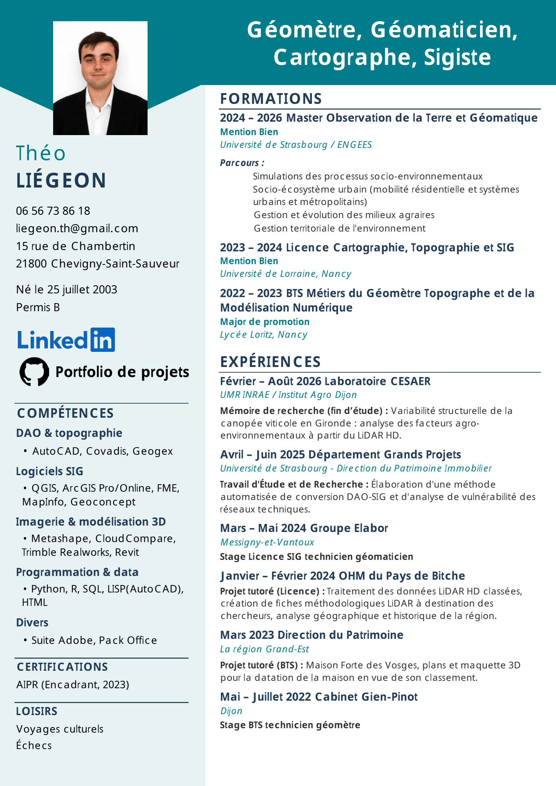

# Mon CV

Cliquez sur l'aperçu ci-dessous pour ouvrir ou télécharger mon CV au format PDF :

# Portfolio de projets

## Présentation

Bienvenue sur mon portfolio GitHub.

Ce dépôt rassemble une sélection de travaux et de projets réalisés tout au long de mon parcours, du BTS au Master, ainsi que quelques réalisations personnelles.

Il est organisé en deux parties :

Travaux de formation : une sélection de rapports, dossiers et réalisations issus de mes différentes formations, classés par diplôme et directement consultables.

Projets : des réalisations présentées dans des dépôts GitHub dédiés, permettant de découvrir plus en détail les démarches suivies, les méthodes employées et, selon les projets, les scripts, données et résultats obtenus.

Ces travaux couvrent différents domaines de la géomatique : **topographie, cartographie, systèmes d'information géographique (SIG), télédétection, analyse spatiale et développement d'outils géospatiaux**.

---

## Projets

### 1. Variabilité structurelle de la canopée viticole en Gironde : analyse des facteurs agro-environnementaux à partir du LiDAR HD

**Contexte :** Mémoire de recherche de Master (fin d'étude) Observation de la Terre et Géomatique – Université de Strasbourg.

**Description :**

Caractérisation de la structure du couvert végétal dans le vignoble girondin à partir des données LiDAR Haute Densité de l'IGN. Le projet comprend le développement de traitements automatisés à grande échelle, l'extraction de métriques structurelles de la canopée et l'analyse des facteurs environnementaux et anthropiques associés à sa variabilité.

**Dépôt :** [LIDAR-HD-Viticulture](https://github.com/lietheo/LIDAR-HD-Viticulture)

---

### 2. Transition de données DAO vers SIG

**Contexte :** Travail d'Etude et de Recherche – Direction du Patrimoine Immobilier de l'Université de Strasbourg.

**Description :**

Élaboration d'une méthode automatisée de conversion de données DAO (AutoCAD) vers un environnement SIG (ArcGIS), intégrant la structuration des données géographiques et la réalisation d'analyses spatiales pour identifier les points de vulnérabilité des réseaux techniques.

**Dépôt :** [TER_DPI](https://github.com/lietheo/TER_DPI)

---

### 3. Développement de plugins QGIS

Ensemble de projets consacrés au développement de plugins QGIS, avec pour objectif de faciliter l'accès aux données géographiques, d'automatiser des traitements et d'enrichir les fonctionnalités du logiciel.

#### RasterFromLiDAR-QGIS

Développement d'un plugin QGIS permettant la génération de modèles numériques de terrain (MNT) raster à partir de données LiDAR. Projet initialement réalisé dans le cadre d'un travail tutoré, puis approfondi dans le cadre d'un projet personnel.

**Dépôt :** [RasterFromLiDAR-QGIS](https://github.com/LIEGEON-QGIS-PLUGINS/RasterFromLiDAR-QGIS)

#### Sentinel2Timelapse-QGIS

Développement d'un plugin QGIS permettant la recherche, la consultation et la visualisation de séries temporelles d'images satellitaires Sentinel-2.

**Dépôt :** [Sentinel2Timelapse-QGIS](https://github.com/LIEGEON-QGIS-PLUGINS/Sentinel2Timelapse-QGIS)

#### Georisques-QGIS

Développement d'un plugin QGIS facilitant l'accès aux données cartographiques officielles de Géorisques. Il permet de rechercher et d'ajouter directement des couches géographiques aux projets QGIS à partir des services web cartographiques WMS et WFS.

**Dépôt :** [Georisques-QGIS](https://github.com/LIEGEON-QGIS-PLUGINS/Georisques-QGIS)

---

### 4. Croisement de sources d'occupation du sol

**Contexte :** Projet universitaire de Master.

**Description :**

Analyse et croisement de différentes sources de données d'occupation du sol afin d'étudier leur complémentarité, leurs différences et leur apport pour la caractérisation de l'occupation du territoire.

*Le rapport complet n'est pas disponible en raison de contraintes de confidentialité liées au contexte professionnel du projet.*

**Ressources :**
- [Code source](https://github.com/lietheo/GEOLAB_GROUPE3_CADASTRE_OCCUPATION)
- [Visualisation interactive](https://lietheo.github.io/GEOLAB_GROUPE3_CADASTRE_OCCUPATION/)

---

### 5. Web Mapping – Risques naturels et technologiques

**Description :**

Conception et réalisation d'une carte interactive permettant de consulter et de visualiser différentes informations géographiques relatives aux risques naturels et technologiques.

**Visualisation :** [Accéder à la carte interactive](https://lietheo.github.io/WEB_MAP/)

---

### 6. Simulation de dégradation forestière

**Description :**

Modélisation et simulation de processus de dégradation des milieux forestiers. Le projet porte sur la représentation spatiale et l'évolution de phénomènes de dégradation forestière.

**Dépôt :** [Group3_ForestDegradationSim](https://github.com/lietheo/Group3_ForestDegradationSim)

---

## Évolution du portfolio

Ce portfolio présente une sélection de mes réalisations universitaires et personnelles. Il sera progressivement enrichi au fil de mes projets et de mes expériences professionnelles.
